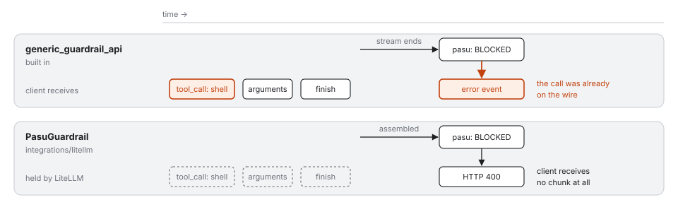

# Integrations

pasu decides; something else may carry the traffic. Every front-end answers
with the same judge — one policy, one audit stream — so a tool call denied
through LiteLLM is denied through Envoy and through pasu's own reverse proxy.

| You run | Attach pasu as | Start pasu with |
|---|---|---|
| nothing yet | the reverse proxy (`base_url` → pasu) | `--frontend reverse --upstream <provider>` |
| [Envoy](envoy/) · [Envoy Gateway](envoy-gateway/) · [agentgateway](agentgateway/) | an **ext_proc** server | `--frontend ext-proc` |
| [LiteLLM](litellm/) proxy | a **guardrail** | `--frontend litellm` |

## What each one covers

| | reverse | Envoy ext_proc | LiteLLM `generic_guardrail_api` | LiteLLM `PasuGuardrail` |
|---|---|---|---|---|
| Prompt screening (block) | ✓ | ✓ | ✓ | ✓ |
| Prompt redaction | ✓ | ✓ | ✓ | ✓ |
| Tool calls, non-streamed | ✓ | ✓ | ✓ | ✓ |
| Tool calls, **streamed** | ✓ before any byte | ✓ before any byte | ✗ chunks reach the client first | ✓ before any chunk |
| Unknown endpoints refused | ✓ | ✓ | LiteLLM's routing | LiteLLM's routing |
| pasu unreachable | — | 500 (`failure_mode_allow: false`) | refused (`unreachable_fallback: fail_closed`) | same |

Streamed tool calls are the reason `PasuGuardrail` exists: LiteLLM consults a
guardrail *while* it streams, so with the built-in integration a denied call is
already on the wire when the block arrives. Measured with LiteLLM 1.91:

<p align="center">
  
</p>

## Envoy

[`envoy/envoy.yaml`](envoy/envoy.yaml). The settings that matter:

- `processing_mode` bodies **BUFFERED**, **STREAMED** or
  **FULL_DUPLEX_STREAMED**. Whichever it is, pasu holds a body it judges until
  the last byte and forwards none of it before the verdict. pasu reads the mode
  Envoy reports and refuses (500) a route whose body it would never see whole:
  with `response_body_mode: NONE` every tool call would otherwise pass unseen,
  and `BUFFERED_PARTIAL` shows only the first part.
- A misconfiguration refusal is a 500 with `"type":"pasu_misconfigured"`; a
  policy refusal is `"type":"pasu_policy_block"`. Alert on both, separately.
- `failure_mode_allow: false` (the default). Never true.
- `message_timeout` above the HITL approval timeout if you run `--ui`.
- `per_connection_buffer_limit_bytes` large enough for your prompts and
  completions; over it Envoy refuses (413 / 500).

What a refusal looks like depends on the mode. Measured with Envoy 1.38, a
streamed (`stream: true`) completion carrying a denied tool call:

| body mode | how pasu holds a body | denied streamed tool call | denied prompt |
|---|---|---|---|
| `BUFFERED` | Envoy buffers it | clean 403 | clean 403 |
| `STREAMED` | answers each piece by clearing it; the last piece carries the whole body | **200 headers, then a reset** — no body byte | clean 403 |
| `FULL_DUPLEX_STREAMED` | answers nothing, and withholds the response headers, until the body is whole | clean 403 | clean 403 |

Under `STREAMED` the response headers have gone to the client before the body
is judged, so a refused completion cannot become a 403: Envoy resets the stream
(curl: `transfer closed with outstanding read data remaining`). No tool-call
byte reaches the client, so it is still fail-closed — but a client sees a
broken stream rather than pasu's error. (A non-streamed completion small
enough to arrive in one piece was still a clean 403 in the same run; do not
rely on it.) Use `BUFFERED` or
`FULL_DUPLEX_STREAMED` to get the error. In every held mode the client gets the
body only once it is whole, as with `BUFFERED`: a streamed completion arrives
all at once, not token by token.

A denied prompt is a clean 403 in every mode, but in `STREAMED` and
`FULL_DUPLEX_STREAMED` the request headers go upstream before the prompt is
judged: the provider sees a request open and then reset, and none of its body.
Use `BUFFERED` if the provider must not see a refused request at all.

`FULL_DUPLEX_STREAMED` needs `request_trailer_mode: SEND` and
`response_trailer_mode: SEND`; Envoy rejects the configuration without them.
It also has no `message_timeout`, which is what lets pasu hold the response
headers. A held body that ends in trailers rather than an end-of-stream piece
is refused (500): LLM APIs do not send trailers. Size limits bound what pasu
holds: over `max_request_bytes` a prompt is refused (413), over
`max_response_bytes` a completion (403). A body pasu does not judge — a
passthrough path, a provider error, a `count_tokens` response, a prompt with
no inspector on — streams through as it arrives.

These are checked against a real Envoy on every CI run:
[`tests/e2e/envoy/run.sh`](../tests/e2e/envoy/run.sh) puts Envoy between curl
and a mock provider, with pasu on the production ruleset, and asserts each
refusal above — including that `NONE` is refused and that a stopped pasu is a
500 — plus that a refused request never reached the provider.

pasu asks the upstream for `accept-encoding: identity`, so no decompressor
filter is needed. Envoy Gateway ([below](#envoy-gateway)) and agentgateway
([below](#agentgateway)) speak the same
protocol. pasu takes the body mode from the `protocol_config` the data plane
sends; Envoy Gateway's `Streamed` works with the reset described above, so
prefer `Buffered` there. Behind Envoy AI Gateway, attach pasu
before AI Gateway's own ext_proc if you redact: AI Gateway can rebuild the
request body and drop an earlier filter's mutation (agent-router#2671).

## agentgateway

[`agentgateway/config.yaml`](agentgateway/config.yaml), standalone
(`agentgateway -f config.yaml`); on Kubernetes the same options sit under
`spec.traffic.extProc`. The settings that matter
([docs](https://agentgateway.dev/docs/standalone/latest/configuration/traffic-management/extproc/)):

- `processingOptions.requestBodyMode` and `responseBodyMode`: the default
  `fullDuplexStreamed` or `buffered` both work. agentgateway reports its body
  modes to pasu, and pasu holds a judged body whole in either. `bufferedPartial`
  and `responseBodyMode: none` are refused with a 500 naming the setting, before
  the request reaches the provider.
- `failureMode: failClosed` (the default). Never `failOpen`: with pasu stopped
  it forwarded every case below, the denied tool call included.
- `frontendPolicies.http.maxBufferSize` large enough for your prompts and
  completions. The default is 2 MiB; a larger buffered body is refused (500)
  and not forwarded.

pasu's `accept-encoding: identity` reaches the provider (a client's `gzip` was
replaced), so no decompression is needed. A streamed completion reaches the
client only once whole, as with Envoy.

Measured with agentgateway 1.5.0 and a plain-HTTP mock provider:

| Case | `buffered` | default (`fullDuplexStreamed`) | pasu stopped |
|---|---|---|---|
| text completion | 200 | 200 | 500 `ext_proc failed`, not forwarded |
| `shell` tool call | 403, no tool-call byte | 403, no tool-call byte | 500, not forwarded |
| `shell` tool call, streamed | 403, no tool-call byte | 403, no tool-call byte | 500, not forwarded |
| `POST /v1/embeddings` | 403, not forwarded | 403, not forwarded | 500, not forwarded |
| prompt with a resident registration number | 403, not forwarded | 403, **body** not forwarded | 500, not forwarded |

In full duplex the request headers go upstream before the body is judged, so
a refused prompt still opens a request at the provider — its path and headers
arrive, its body never does. Use `buffered` if the provider must not see the
request at all.

## Envoy Gateway

[`envoy-gateway/`](envoy-gateway/): pasu as a Deployment + Service
([`pasu.yaml`](envoy-gateway/pasu.yaml)), attached to an HTTPRoute with an
`EnvoyExtensionPolicy` ([`extension-policy.yaml`](envoy-gateway/extension-policy.yaml)).
[`gateway.yaml`](envoy-gateway/gateway.yaml) and
[`mock-provider.yaml`](envoy-gateway/mock-provider.yaml) are the rest of the
test setup.

```sh
kubectl apply -f integrations/envoy-gateway/pasu.yaml
kubectl -n pasu create configmap pasu-rules --from-file=rules.yaml=deploy/rules.yaml
kubectl apply -f integrations/envoy-gateway/mock-provider.yaml \
              -f integrations/envoy-gateway/gateway.yaml \
              -f integrations/envoy-gateway/extension-policy.yaml
```

The settings that matter:

- `processingMode.request.body` and `processingMode.response.body` both
  **`Buffered`** (recommended; measured). `BufferedPartial` or a missing
  `response` block is a 500 that names the setting. `Streamed` and
  `FullDuplexStreamed` were refused too when this was measured; pasu now holds
  those whole (verified on Envoy 1.38 and agentgateway, not re-run on Envoy
  Gateway), with the refusal shapes described under [Envoy](#envoy).
- **Do not leave out `processingMode`.** Without it Envoy Gateway sends pasu no
  message at all — every request, denied tool calls and `/v1/embeddings`
  included, reached the provider unjudged. pasu cannot detect this; it is never
  called.
- `failOpen: false` (the default), and no `shadowMode`. With `failOpen: true`
  and pasu down, everything passed. `shadowMode` sends pasu the traffic and
  ignores its answers: with it, a denied tool call and `/v1/embeddings` both
  passed.
- `messageTimeout` above your slowest judgment — Envoy Gateway's default is
  200 ms; above the HITL approval timeout (120 s) if you run `--ui`. A timeout
  is a 504 to the client, not a pass.
- A `ClientTrafficPolicy` with `connection.bufferLimit` (64 Mi in the example).
  The 32 KiB default refused a 100 KiB prompt (413, the provider never saw it)
  and a 256 KiB completion (500). The one policy on the Gateway lifted both; a
  `BackendTrafficPolicy` was not needed.

Measured with Envoy Gateway **v1.9.2** (Helm chart
`oci://docker.io/envoyproxy/gateway-helm`) on kind v0.33.0, Kubernetes
v1.37.0, against the mock provider in plain HTTP:

| Case | Client got | Provider saw |
|---|---|---|
| text, non-streamed and streamed | 200 | the request, `accept-encoding: identity` (client sent `gzip`) |
| `shell` tool call, non-streamed | 403 `pasu_policy_block`, no tool-call bytes | the request |
| `shell` tool call, streamed | 403 `pasu_policy_block`, no chunk | the request |
| `POST /v1/embeddings` | 403 | nothing |
| prompt with an RRN (`--block-pii-kr`) | 403 | nothing |
| 100 KiB prompt / 256 KiB completion | 200 / 200 | the request |
| pasu scaled to 0 | 500 | nothing |
| `response.body` / `request.body: Streamed` | 500 naming the setting — **before** pasu held streamed bodies; see above | nothing |
| `messageTimeout: 1ms` | 504 | one request of three (the timeout hit a later phase); its answer did not reach the client |
| `processingMode` left out | **200, tool call delivered** | everything |
| `failOpen: true`, pasu down | **200, tool call delivered** | everything |
| `shadowMode: true` (Envoy Gateway rejects it with `Buffered`) | **200, tool call delivered** | everything |

The last three rows are the configurations that fail open; the rest fail closed.

## LiteLLM

[`litellm/config.example.yaml`](litellm/config.example.yaml). Use
`generic_guardrail_api` if you never stream tool calls, or
[`pasu_guardrail.py`](litellm/pasu_guardrail.py) (placed next to the config) if
you do. Either way: `mode: [pre_call, post_call]`, `default_on: true`,
`unreachable_fallback: fail_closed`. Set `PASU_GUARDRAIL_API_KEY` on pasu and
`api_key` in LiteLLM to require a shared key.

LiteLLM has a built-in `tool_permission` guardrail for name and argument
patterns. pasu is for when the same policy must also bound the kernel egress
layer, hold calls for a person (`Ask`), redact Korean PII, or feed one audit
stream across every front-end.
